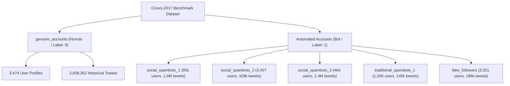
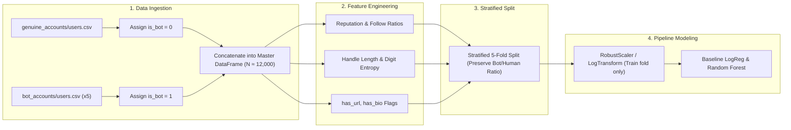

# Sentinal AI: Phase 1 — Dataset Inspection & Technical Audit Report

> **Project:** Sentinal AI — Applied ML Bot Detection & Classification Benchmark  
> **Target Dataset:** Cresci-2017 Benchmark Dataset  
> **Phase:** 1 of 7 (Dataset Inspection & Validation)  
> **Status:** Draft for review; model training had not started when this audit was prepared.

---

## 1. Summary

This audit reviews the repository's dataset files, schemas, and provenance. The files examined include a tweet-level CSV and a user-profile CSV.

### Findings
1. The workspace was synchronized from `C:\Users\VARDHAN\Downloads\SENTINAL AI ML`.
2. `data/raw/cresci17/tweets.csv` contains 2,839,362 records and is consistent with the Cresci-2017 genuine-account tweet corpus.
3. The tweet file contains 1,084 distinct account IDs and no bot labels. Treating each tweet as an independent account-level training example could place tweets from the same user in both training and test sets.
4. `users-selected-columns.csv` contains 3,474 genuine-account profiles. The five bot subsets were not present in `data/raw/` when this audit was prepared.
5. The tweet file contains non-UTF-8 characters; `latin1` (ISO-8859-1) can be used to read it.

---

## 2. Existing Repository Files & Architectural Purpose

The repository is available at [`https://github.com/VardhanVersion2/Sentinal-AI-Applied-ML-Bot-Detection-Classification-Benchmark`](https://github.com/VardhanVersion2/Sentinal-AI-Applied-ML-Bot-Detection-Classification-Benchmark). Its relevant files and directories are:

```
SENITAL AI/
├── .gitignore                      # Git exclusion rules for large datasets and environments
├── LICENSE                         # MIT License
├── README.md                       # Project specification and high-level workflow
├── requirements.txt                # Pinned dependencies for ML, EDA, and deployment
├── docs/
│   ├── dataset_inventory.md        # Cresci-2017 schema and class mapping specifications
│   └── audit_report_phase1.md      # This technical audit report
├── notebooks/
│   └── 01_dataset_inspection.ipynb # Jupyter notebook for interactive EDA and loading
├── src/
│   └── data/
│       └── __init__.py             # Python package marker for data pipelines
└── data/
    ├── interim/ (.gitkeep)         # Cleaned intermediate merged tables
    ├── processed/ (.gitkeep)       # Train/test features ready for model estimators
    └── raw/
        ├── cresci17/
        │   └── tweets.csv          # Raw tweet stream (1.01 GB, 2,839,362 rows)
        └── users-selected-columns.csv # 3,474 genuine human account metadata rows
```


## 3. Actual Dataset Folder Structure & Provenance Verification

### Cresci-2017 benchmark subsets

In their seminal research paper (*"The paradigm-shift of social spambots: Evidence, theories, and tools for detecting them"*, ACM WWW 2017), Stefano Cresci et al. established the benchmark using 6 distinct subsets:



### Local file checks

We verified the local datasets against the Cresci-2017 publication figures:

#### 1. `data/raw/cresci17/tweets.csv`
- **File size:** 1,011,418,427 bytes (~1.01 GB)
- **Line count:** 2,839,364 lines (header, 2,839,362 records, and a trailing newline).
- **Comparison:** The record count matches the published volume for Cresci-2017 `genuine_accounts/tweets.csv`.
- **Unique Users:** 1,084 distinct `user_id` values.
- **Overlap:** 1,062 of these 1,084 users exist in `users-selected-columns.csv`.

#### 2. `data/raw/users-selected-columns.csv`
- **File size:** 230,206 bytes (230 KB)
- **Row count:** Exactly **3,474 rows**.
- **Comparison:** This is the reported number of accounts in Cresci-2017 `genuine_accounts/users.csv`.
- **Target Label:** All 3,474 accounts belong to **Class 0 (Human / Genuine)**.

> **Dataset limitation:** The files examined contain 3,474 human accounts and no bot accounts. A supervised binary classifier requires examples from both classes. The five bot subsets (`social_spambots_1`, `social_spambots_2`, `social_spambots_3`, `traditional_spambots_1`, and `fake_followers`) were not present in `data/raw/`.

---

## 4. In-Depth CSV Schemas & Statistical Audit

### Schema 1: Account-Level Profile Schema (`users-selected-columns.csv`)

| Column Name | Inferred Dtype | Missing Count | Missing % | Description & Sample Value |
| :--- | :--- | :--- | :--- | :--- |
| `id` | `int64` | 0 | 0.00% | Unique Twitter user ID (`1502026416`) |
| `name` | `object` (string) | 1 | 0.03% | Profile display name (`TASUKU HAYAKAWA`) |
| `screen_name` | `object` (string) | 0 | 0.00% | Account handle without @ (`0918Bask`) |
| `statuses_count` | `int64` | 0 | 0.00% | Cumulative count of all lifetime tweets posted |
| `followers_count` | `int64` | 0 | 0.00% | Number of accounts following this user |
| `friends_count` | `int64` | 0 | 0.00% | Number of accounts this user follows |
| `favourites_count`| `int64` | 0 | 0.00% | Total tweets liked/favorited by this user |
| `listed_count` | `int64` | 0 | 0.00% | Number of public Twitter lists containing user |
| `url` | `object` (string) | 2,208 | 63.56% | Bio external website URL |
| `lang` | `object` (string) | 0 | 0.00% | UI language code (e.g., `en`, `es`, `ja`) |

#### Descriptive Statistics for Numerical Features (Genuine Accounts, N=3,474)

| Metric | `followers_count` | `friends_count` | `statuses_count` | `favourites_count` | `listed_count` |
| :--- | :--- | :--- | :--- | :--- | :--- |
| **Mean** | 1,393.22 | 633.24 | 16,958.22 | 4,669.62 | 19.50 |
| **Std Dev** | 17,216.66 | 1,600.96 | 30,696.29 | 11,527.57 | 157.74 |
| **Min** | 1 | 0 | 3 | 0 | 0 |
| **25% (Q1)** | 149.00 | 169.00 | 1,810.25 | 261.25 | 0.00 |
| **50% (Median)** | 341.00 | 319.00 | 6,609.00 | 1,286.00 | 2.00 |
| **75% (Q3)** | 803.75 | 635.75 | 19,467.00 | 4,727.00 | 8.00 |
| **Max** | 986,837 | 46,310 | 399,555 | 313,954 | 6,166 |

---

### Schema 2: Tweet Stream Schema (`tweets.csv`)

| Column Name | Inferred Dtype | Missing % (Sample) | Semantic Significance |
| :--- | :--- | :--- | :--- |
| `id` | `int64` | 0.0% | Unique Tweet ID |
| `text` | `object` | <0.1% | Tweet text content |
| `source` | `object` | <0.1% | Tweet client application HTML anchor |
| `user_id` | `int64` | 0.0% | Foreign Key linking to `users.csv:id` |
| `truncated` | `float64` | 100.0% | Boolean flag; entirely empty |
| `in_reply_to_status_id` | `int64` | 0.0% | ID of parent tweet (0 if original post) |
| `in_reply_to_user_id` | `int64` | 0.0% | ID of parent user (0 if original post) |
| `in_reply_to_screen_name` | `object` | 66.1% | Handle of parent user |
| `retweeted_status_id` | `int64` | 0.0% | ID of original retweeted status (0 if original post) |
| `geo`, `place`, `contributors` | `float64`/`object` | 86.0% - 100.0% | Geographic coordinate fields; heavily sparse |
| `retweet_count`, `reply_count`, `favorite_count` | `int64` | 0.0% | Engagement metrics |
| `num_hashtags`, `num_urls`, `num_mentions` | `int64` | 0.0% | Syntactic entity frequency counters |
| `created_at` | `object` | 0.0% | Timestamp string (RFC 2822: `Fri May 01 00:18:11 +0000 2015`) |
| `timestamp`, `crawled_at`, `updated` | `object` | 0.0% | Crawl metadata timestamps |

---

## 5. Data quality issues

### Issue 1: Tweet-level and account-level data
- `tweets.csv` has 2,839,362 rows, but represents only **1,084 distinct humans**.
- If treated as account records:
  1. A single user with 3,000 tweets would be sampled 3,000 times, violating the Independent and Identically Distributed (I.I.D.) assumption of standard ML models.
  2. Any random train/test split would bleed the same user's tweets across both training and validation sets, resulting in catastrophic target leakage.
- **Recommendation:** Use user profiles as the unit of analysis. Tweets can be aggregated into per-user features (such as mean retweets or URL frequency), but should not be treated as independent account records.

### Issue 2: Extreme Distributional Skewness & Heavy Tails
- The standard deviation of `followers_count` is 17,216, while the median is just 341.
- Maximum values reach nearly 1,000,000.
- Standard unscaled Linear/Logistic Regression models will suffer from extreme gradient dominance driven by outliers.
- **Recommendation:** Apply a log transform ($\log(x + 1)$) or robust scaling before fitting linear models. Tree models do not require scaling, though ratios may still be useful features.

### Issue 3: Zero-Division in Ratio Features
- Minimum `friends_count` is 0.
- Naive calculation of $\text{Followers} / \text{Friends}$ causes `ZeroDivisionError` or generates `inf`.
- **Recommendation:** Use a bounded reputation ratio:
  $$\text{Reputation Ratio} = \frac{\text{Followers}}{\text{Followers} + \text{Friends} + 1}$$
  This strictly bounds the metric to the range $[0.0, 1.0]$.

### Issue 4: Missing Metadata Fields in the Extracted Subset
- `users-selected-columns.csv` lacks `created_at` (account creation date).
- Account age is one of the strongest predictive signals for bot detection (bots are frequently freshly created throwaway accounts).
- **Recommendation:** Obtain the `users.csv` files for all six Cresci categories if these fields are needed. They include `created_at`, `default_profile_image`, `verified`, and `description`.

---

## 6. Proposed Preprocessing & Engineering Strategy



### Preprocessing Protocol
1. **Source Unification:**
   - Ingest all 6 official subfolders under `data/raw/cresci2017/`.
   - Maintain multi-class provenance (`account_category`) alongside binary target `is_bot`.
2. **Text & Categorical Sanitization:**
   - Create binary indicators: `has_url = int(notna(url))`, `has_name = int(notna(name))`.
   - Extract screen name metadata: length of `screen_name`, count of digits, ratio of digits to length.
3. **Leakage Protection:**
   - No transformations (scaling, imputations, frequency encodings) will be calculated on the full dataset. All transformers will be fit exclusively inside cross-validation training folds.
4. **Benchmarking Metrics Selection:**
   - Given expected class distributions, simple accuracy will be deprecated in favor of:
     * **PR-AUC (Precision-Recall Area Under Curve):** Useful when class counts are imbalanced.
     * **F1-Score (Macro and bot-specific):** Summarizes precision and recall.
     * **ROC-AUC:** Measures how well the model ranks positive examples above negative examples.

---

## 7. Approval Checklist for Transition to Phase 2 (EDA)

Before beginning Phase 2 (Exploratory Data Analysis) and Phase 3 (Feature Engineering), please confirm:
- [ ] Confirm ingestion path for the full Cresci-2017 bot classes (`social_spambots_1/2/3`, `traditional_spambots_1`, `fake_followers`).
- [ ] Approve the proposed account-level unit of analysis (and the exclusion of raw tweet rows as individual classification targets).
- [ ] Approve the feature engineering formulas ($\log(1+x)$ transforms and bounded Reputation Ratio).
